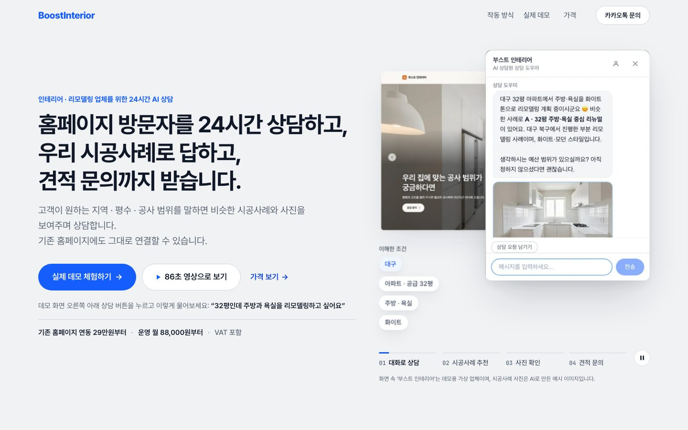
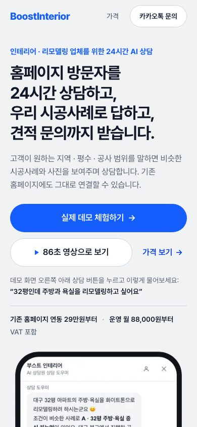

# BoostInterior Sales Landing V3: 구조 개편 (HOME · /pricing · /pricing/details)

`prompt` (BOOSTINTERIOR SALES LANDING V3 — FULL CRO RESTRUCTURE + CONVERSION-FOCUSED IMPLEMENTATION) 결과 보고서.
작업일 2026-10-05. 선행 문서는 [`BOOSTINTERIOR-LANDING-CRO-AUDIT-2026-10-05.md`](./BOOSTINTERIOR-LANDING-CRO-AUDIT-2026-10-05.md)이다.

디자인을 새로 그린 것이 아니다. 색 · 글꼴 · 모션 · 제품 화면 asset은 그대로 두고, 순서 · 위계 · 문구 · 버튼 이름 · 스크롤 길이 · 가격 판단 흐름을 바꿨다.
**배포하지 않았고 push하지 않았다.** 로컬 `main`에 커밋 4개가 있다 (보고서 커밋 포함).

---

## Report

```
STATUS               = 구현 · 검증 완료, 로컬 커밋만. 광고 투입 전에 owner 입력 3건이 남았다 (아래 OWNER_INPUT_REQUIRED 1~3)
LIVE_CHANGED         = NO   (push · deploy 없음. 운영 사이트는 그대로다)

HOME_V3              = DONE  13개 section, prompt의 순서 그대로. 19개 → 13개
PRICING_V3           = DONE  9개 section, prompt의 순서 그대로
PRICING_DETAILS_V3   = DONE  상단 요약 · 바로 가기 · /pricing으로 돌아가기 · FAQ · Final CTA

HERO                 = H1이 무엇을 하는지 말한다. 채워진 버튼 1개(실제 데모 체험하기), 86초 영상 · 가격 보기는 보조.
                       가격 한 줄(29만원부터 · 월 88,000원부터 · VAT 포함)이 첫 화면에 있다
QUICK_VALUE          = 4가지 (24시간 상담 · 우리 시공사례 추천 · 견적 문의 정리 · AI Portfolio Video[Growth 플랜 표시])
                       데스크톱 0.42 화면, 모바일 0.67 화면
VIDEO_SECTION        = 3번째로 이동 (데스크톱 19.6 → 1.4 화면째). 자동 재생 없음, 누르기 전에는 mp4를 받지 않는다.
                       장면 5개 바로 가기, 아래에 사실 3줄. 휴대폰에서는 재생 시 전체 화면으로 열린다
WALKTHROUGH          = 4단계. 장면 8개(대화 · 추천 · 크게 보기 · 사진 · 조건 기억 · 견적 문의 · 대표님 화면 · 모바일)
                       → 흐름 안의 3단계 + 관리자 화면. 데스크톱 16.6 → 4.0 화면
ADMIN_PROOF          = 4단계의 마지막이자 독립 section. 데스크톱 15.6 → 6.3 화면째, 모바일 7.5 → 6.6 화면째
LIVE_DEMO            = 7번째 (데스크톱 25.4 → 7.6 화면째). 버튼 바로 위에 예시 질문, "가입 없이 새 창에서" 안내
ONBOARDING           = 5단계, 대표님이 할 일은 1개(홈페이지 주소 보내기). 내부 용어 0개, 소요 일수 언급 없음
PRICING_HELPER       = "내 상황에 맞는 선택" 문장 7개(구축 4 · 플랜 3). 누르면 /pricing의 해당 카드로 간다
QUICK_START_BADGE    = "인기상품" 삭제 → "홈페이지가 없다면 추천". 판매 근거가 repo에 없다
FOUNDING_PARTNER     = Hero 바로 아래(1.0 화면째) → 12번째(12.1 화면째). 1,075px → 625px. 자체 버튼 없음, #partner 유지
PORTFOLIO_VIDEO_SAMPLE         = NONE  (lib/site.ts PORTFOLIO_VIDEO_SAMPLE = null. 실제 결과물 asset이 없다)
PORTFOLIO_VIDEO_PUBLIC_PREVIEW = NO    (빈 틀 · 대체 이미지도 넣지 않았다. asset을 넣으면 3곳에 자동으로 나온다)
TRUST                = 직접 써볼 수 있음 · 가격 전부 공개 · 화면은 실제 제품. 고객 수 · 후기 · 수치 · 마감 0개
                       데모 화면의 업체 · 시공사례 · 문의가 예시이고 사진이 AI 이미지라는 것을 밝혔다
BUSINESS_INFO_PUBLIC = NO   (상호 · 대표자 · 사업자등록번호 · 주소 · 이메일이 repo 어디에도 없다. 지어내지 않았다)
OWNER_INPUT_REQUIRED = YES  1) 운영자(사업자) 정보  2) 약정 · 해지 · 환불 · 과금 시작 · 답변 시간 · 플랜 변경 정책
                            3) Quick Start · 맞춤 제작의 호스팅/주소 비용과 수정 지원 범위  4) AI Portfolio Video 실제 sample
                            5) 방문자 분석 화면 캡처  6) 관리자 화면 재촬영  (자세한 내용은 아래)
DEMO_FOLLOWUP_REQUIRED = YES  데모 사이트와 카카오 오픈채팅 쪽 5건. 이 repo 밖이다 (아래)

DESKTOP_LENGTH       = HOME 1440×900: 26,296px (29.2 화면) → 12,131px (13.5 화면). −54%
MOBILE_LENGTH        = HOME 390×844:  16,257px (19.3 화면) → 12,852px (15.2 화면). −21%
                       권장 범위(10~13 화면)에는 못 들어갔다. 내용을 숨겨서 맞추지 않았다 (KNOWN_ISSUES 4)

TYPECHECK            = PASS  (next typegen && tsc --noEmit)
LINT                 = PASS  (eslint)
BUILD                = PASS  (next build, 정적 11/11. / · /pricing · /pricing/details 모두 static)
TEST                 = PASS  (npm test, 27/27. V3에서 9개 추가)
BROWSER_QA           = PASS  로컬 production build(next start), Chromium. 5개 viewport × 3개 route = 15 상태
                       console error 0 · failed request 0 · 가로 overflow 0 · 깨진 이미지 0 · 44px 미만 터치 영역 0
                       중복 id 0 · h1 1개씩 · 링크 43개 중 불량 0 · 첫 화면의 채워진 버튼 1개씩
                       실제 기기 · iOS Safari · 인앱 브라우저는 확인하지 못했다 (KNOWN_ISSUES 7)
INDEPENDENT_REVIEW   = DONE  새 context의 reviewer. BLOCKER 2 · MAJOR 8 · MINOR 12
                       BLOCKER 1건 수정, 1건은 owner 입력 대기. MAJOR 2건 수정 · 3건 부분 수정 · 2건 owner 대기 · 1건 미채택
KNOWN_ISSUES         = 9건 (아래)
GIT                  = d1d0d20 feat(sales): restructure BoostInterior landing and pricing V3
                       09c13bc fix(sales): address V3 CRO review findings
                       074a932 fix(sales): keep decision rows and large buttons inside 320px screens
                       + 이 보고서 커밋 (docs(sales): record Landing V3 release)
                       `prompt`와 CRO audit 문서는 커밋하지 않았다. force push 없음
PUSHED               = NO
```

---

## 1. HOME: 무엇이 어디로 갔나

| # | V3 section | id | 이전 위치 (1440) | 지금 위치 (1440 / 390) | 높이 (1440 / 390) |
|---|---|---|---|---|---|
| 01 | Hero | `top` | 0 | 0 / 0 | 0.94 / 1.34 화면 |
| 02 | Quick Value | `value` | 없음 (신규) | 0.9 / 1.3 | 0.42 / 0.67 |
| 03 | 실제 작동 영상 | `demo-video` | 19.6 | 1.4 / 2.0 | 1.43 / 0.90 |
| 04 | 왜 필요한가 (Problem + Before/After 합침) | `problem` | 2.2 + 21.1 (2개) | 2.8 / 2.9 | 0.83 / 0.95 |
| 05 | 작동 방식 4단계 | `how` | 3.0~17.7 (고정 장면) | 3.6 / 3.9 | 2.70 / 2.74 |
| 06 | 대표님 화면 | `owner` | 15.6 | 6.3 / 6.6 | 1.30 / 1.07 |
| 07 | 실제 데모 | `live` | 25.4 | 7.6 / 7.7 | 0.78 / 0.54 |
| 08 | 도입 과정 | `install` | 22.8 + 24.9 (2개) | 8.4 / 8.2 | 0.90 / 1.16 |
| 09 | 가격 요약 + 선택 도우미 | `pricing` | 26.4 | 9.3 / 9.4 | 1.40 / 2.16 |
| 10 | FAQ 5개 | `faq` | 없음 (신규) | 10.7 / 11.5 | 0.63 / 0.69 |
| 11 | 만든 이유 · 신뢰 | `why` | 22.1 | 11.4 / 12.2 | 0.72 / 1.08 |
| 12 | 초기 파트너 | `partner` | 1.0 | 12.1 / 13.3 | 0.69 / 1.05 |
| 13 | 문의 (Final CTA) | `contact` | 28.5 | 12.8 / 14.4 | 0.57 / 0.65 |

- 합쳐서 없앤 것: `BeforeAfter`, `InstallPaths`, `MobileScene`, `StoryRail`, `StoryScene` (컴포넌트 5개 삭제). CSS로 순서만 바꾼 곳은 없다.
- 고정 스크롤(pinned) 장면은 전부 없앴다. 지금 모션은 화면에 들어올 때 한 번 나타나는 것뿐이고, `prefers-reduced-motion`에서는 전부 꺼진다.
- Header: 데스크톱 `작동 방식 · 실제 데모 · 가격 · [카카오톡 문의]`, 모바일 `가격 · [카카오톡 문의]`. 카카오톡 버튼은 테두리 버튼이라 Hero의 채워진 버튼과 경쟁하지 않는다.
- 버튼 이름: 데모는 "실제 데모 체험하기" 하나, 카카오톡은 "카카오톡 문의"와 "내 홈페이지 기준으로 추천받기" 둘. "도입 상담 · 1:1 도입 상담 · 초기 파트너로 상담 · 상담받기"는 전부 지웠고 테스트가 다시 쓰는 것을 막는다.

## 2. BEFORE / AFTER METRICS

| 지표 | BEFORE | AFTER |
|---|---|---|
| HOME_HEIGHT (1440×900) | 26,296px | 12,131px |
| HOME_VIEWPORTS (1440×900) | 29.2 | 13.5 |
| HOME_HEIGHT (390×844) | 16,257px | 12,852px |
| HOME_VIEWPORTS (390×844) | 19.3 | 15.2 |
| SECTION_COUNT | 19 | 13 |
| WALKTHROUGH_DESKTOP_VIEWPORTS | 16.6 (14,940px) | 4.0 (3,604px = `how` 2,433 + `owner` 1,171) |
| FIRST_PRICE_POSITION (1440) | 24,496px · 27.2 화면째 · 페이지의 93% | 668px · 0.74 화면째 (Hero) |
| FIRST_PRICE_POSITION (390) | 12,662px · 15.0 화면째 | 604px · 0.72 화면째 (Hero) |
| PRIMARY_CTA_COUNT_ABOVE_FOLD | 2 (카카오톡 도입 상담 + 실제 데모 체험하기) | 1 (실제 데모 체험하기) |
| /pricing (1440 / 390) | 3,739px (4.2) / 6,308px (7.5) | 5,328px (5.9) / 9,028px (10.7) |
| /pricing/details (1440 / 390) | 9,231px (10.3) / 12,529px (14.8) | 9,431px (10.5) / 13,012px (15.4) |

다른 viewport의 HOME (AFTER): 1024×768 12,670px (16.5 화면) · 768×1024 11,517px (11.2) · 375×667 12,953px (19.4).

**/pricing은 길어졌다.** prompt가 추가하라고 한 "내 상황에 맞는 선택"(754px)과 "플랜을 올리면 이것이 더해집니다"(732px)가 들어갔기 때문이다. 줄인 것이 아니라 판단에 필요한 것을 넣은 결과다. reviewer는 이 중복을 MAJOR로 봤다 (3장 M8).

## 3. /pricing 과 /pricing/details

`/pricing` 순서: Hero + 가장 가볍게 시작하면(29만원 + 월 88,000원) → 내 상황과 가장 가까운 문장을 고르세요 → 초기 구축 A~D → 운영 플랜 → 어떤 조합을 골라도 같습니다 → 플랜을 올리면 이것이 더해집니다 → 상세 범위 링크 → 초기 파트너 요약 → Final CTA.

- Growth 카드 아래에 "Core보다 월 110,000원 추가", Managed에 "Growth보다 월 99,000원 추가"를 적고, 그 돈으로 무엇이 더해지는지를 비교표에서 그대로 읽어 온다 (`planAdditions`). 문구를 따로 쓰지 않으므로 비교표와 어긋날 수 없다.
- Core 카드에 "AI 상담 · 시공사례 추천 · 견적 문의는 Core부터 모두 포함됩니다"를 넣어 Core가 깎인 플랜으로 읽히지 않게 했다.

`/pricing/details`: 맨 위 "← 가격 한눈에 보기로 돌아가기", "한눈에 요약" 카드(금액 7개가 각자의 위치로 가는 링크), "바로 가기" 5개, 본문, FAQ 12개, 초기 파트너 요약, Final CTA + 돌아가기.

HOME → /pricing → /pricing/details 순서는 한 방향이다. 랜딩은 상세 범위로 바로 보내지 않는다 (테스트로 고정).

## 4. INDEPENDENT REVIEW

새 context의 reviewer에게 원하는 결론을 알려주지 않고, conversion · clarity · trust · scroll fatigue · mobile · pricing decision 기준으로 광고 투입을 막을 문제를 찾게 했다. reviewer의 결론은 **"아직 광고를 보내지 말 것"**이었다.

| # | 등급 | 지적 | 처리 |
|---|---|---|---|
| B1 | BLOCKER | "화면 속 업체와 문의만 데모용 가상 데이터"라고 썼는데, 데모 사이트 스스로 "시공사례 · 후기는 데모용 예시, 사진은 AI로 생성한 예시 이미지"라고 밝힌다. 사실과 다르다 | **수정.** 직접 확인했다 (데모 footer 문구). Hero · footer · "만든 이유"의 안내를 "업체와 시공사례, 문의는 데모용 예시이고 사진은 AI로 만든 예시 이미지"로 고쳤고 테스트로 고정했다 |
| B2 | BLOCKER | 누가 파는지 알 수 없다. footer에 상호 · 대표자 · 사업자등록번호 · 주소 · 이메일이 없다 | **owner 대기.** repo에 정보가 없고 지어낼 수 없다. OWNER_INPUT_REQUIRED 1 |
| M1 | MAJOR | 86초 영상은 1920×1080 데스크톱 녹화라 휴대폰에서 350px 폭으로 재생되면 글자를 읽을 수 없다 | **부분 수정.** 휴대폰(≤820px)에서는 재생 시 전체 화면으로 열고, "가로로 돌리면 글자가 잘 보입니다"를 적었다. 세로 화면용 편집본은 새 asset이 필요해 만들지 않았다 |
| M2 | MAJOR | 약정 · 해지 · 환불 · 과금 시작이 어디에도 없고, "플랜을 변경할 수 있나요?"의 답이 답이 아니다 | **owner 대기.** 정해지지 않은 정책을 사실처럼 쓸 수 없다. 플랜 변경 문항은 V3 이전부터 같은 답이었고 그대로 뒀다. reviewer는 삭제를 권했다. 정책이 정해지면 답을 쓰는 쪽이 낫다고 판단했다 |
| M3 | MAJOR | 홈페이지가 없는 대표는 첫 청구액을 알 수 없다. B · D에 호스팅/주소 비용 포함 여부, 플랜을 멈추면 홈페이지가 어떻게 되는지, 수정 지원의 범위가 없다 | **owner 대기.** OWNER_INPUT_REQUIRED 3 |
| M4 | MAJOR | Managed의 "월 1회 방문 · 상담 데이터 함께 확인"이 "월 1회 방문"(현장 방문)으로 읽힌다 | **수정.** "월 1회 방문자 · 상담 데이터 함께 확인". 이전에 승인된 비교표 문구를 한 단어 바꾼 것이므로 원치 않으면 되돌리면 된다 (`lib/pricing.ts` 2곳, 테스트 1곳) |
| M5 | MAJOR | Growth의 추가 11만원에 시각 증거가 없고, 카드는 "건수 제한 없음"인데 FAQ는 "새롭게 등록되는 시공사례 기준"이라 범위가 어긋난다 | **부분 수정.** FAQ의 조건을 카드 주석과 영상 설명에도 넣어 맞췄다. sample 영상과 방문자 분석 화면은 실제 asset이 없어 넣지 못했다 |
| M6 | MAJOR | 데모 버튼을 누르면 가상 업체 홈페이지에 떨어지는데, 어디를 눌러야 하는지는 7.6 화면 아래에만 있다. 데모에는 돌아오는 길이 없다 | **부분 수정.** Hero의 예시 질문 줄을 "데모 화면 오른쪽 아래 상담 버튼을 누르고 이렇게 물어보세요"로 바꿨다. 데모 쪽 문제는 repo 밖이다 |
| M7 | MAJOR | "내 홈페이지 기준으로 추천받기"가 카카오톡으로 간다는 말이 6곳 중 1곳에만 있다 | **수정.** 버튼이 있는 5개 파일 전부에 "BoostWorks 카카오톡 1:1 오픈채팅으로 연결됩니다."를 붙였고 테스트로 고정했다 |
| M8 | MAJOR | /pricing과 /pricing/details의 첫 두 화면이 앞 페이지의 반복이다. 선택 도우미는 랜딩에만 두고, 상세의 가격 목록은 빼자 | **미채택.** /pricing의 "내 상황에 맞는 선택"과 상세의 상단 요약은 prompt가 지정한 구조다. 중복 자체는 사실이므로 결정이 필요하다 (KNOWN_ISSUES 5) |

MINOR 12건 중 고친 것: Hero 가격 줄 끝에 매달리던 "·", 태블릿 · 작은 노트북에서 H1이 절 중간에서 끊기던 것(이제 481~1279px에서도 절 사이에서만 끊긴다), 휴대폰에서 10px 안팎이던 "부터"(최소 12px), 영상 길이 표기(86초로 통일), "홈페이지를 새로 만드는 것이 아니라"가 새 홈페이지 상품과 부딪히던 것. reviewer가 요청 범위 밖이라며 따로 적은 320px 폭의 가로 넘침도 고쳤다.

고치지 않은 MINOR와 이유:
- "기존 홈페이지 연동 29만원부터", "86초 영상으로 보기", "가격 자세히 보기": prompt가 지정한 문구다.
- 관리자 화면 캡처 속 "[DEMO CAPTURE] 영업영상 제작용 테스트 문의" · "영업 데모 고객" · "bi-04": 제품 관리 화면에서 다시 찍어야 한다 (OWNER_INPUT_REQUIRED 6).
- 영상 바로 아래에 버튼이 없다 (휴대폰에서 0.5~6.4 화면 사이에 본문 버튼 없음, header의 카카오톡 문의만 있다): sticky CTA는 prompt가 필수가 아니라고 했고, 버튼을 늘리면 Hero의 버튼 하나 원칙이 흐려진다. 판단을 남긴다.
- 초기 파트너 6개 혜택에 기한이 없다: prompt가 유지하라고 한 내용이고 제목 6개는 테스트로 고정돼 있다.
- 월 비용을 "운영 플랜 · 월 이용료 · 월 운영료"로 섞어 부른다: VAT 문구가 테스트로 고정돼 있어 이번에는 손대지 않았다.
- /pricing의 A 카드가 두 줄뿐이라 가장 흔한 선택이 무엇을 사는지 보여주지 못한다, 랜딩이 같은 4단계를 H1 · 한눈에 보기 · 영상 장면 · "왜 필요한가"에서 먼저 말한다, 캡처 속 링크처럼 보이는 글자가 눌리지 않는다: 손대지 않았다. 앞의 둘은 내용을 더 넣거나 빼는 결정이고, 마지막은 캡처 자체의 문제다.
- 데모 메뉴의 "3D 시공사례": 데모 사이트 쪽이다 (5장).

reviewer가 확인하지 못했다고 밝힌 것: 사업자 정보 표기의 법적 · 광고 플랫폼 요건, 한국에서의 데모 로딩 속도, 인앱 브라우저와 실제 iOS Safari.

## 5. Owner가 정하거나 줘야 하는 것

**OWNER_INPUT_REQUIRED**

1. **운영자 정보.** 상호, 대표자, 사업자등록번호, 주소, 이메일(또는 연락 수단). footer 한 줄이면 된다. 지금 footer는 "BoostInterior by BoostWorks"뿐이다.
2. **정책 (OWNER_POLICY_REQUIRED).** 약정 기간, 해지, 환불, 과금 시작 시점, 답변 시간, 플랜 변경. 정해지면 FAQ에 답을 쓴다. 지금은 어느 페이지도 이 중 어느 것도 말하지 않는다 (테스트로 막아 두었다).
3. **홈페이지를 새로 만드는 상품(Quick Start · 맞춤 제작)의 조건.** 호스팅과 주소(도메인) 비용이 포함되는지, 월 플랜을 멈추면 홈페이지가 어떻게 되는지, "수정이 필요한 경우 반영을 지원"의 범위.
4. **AI Portfolio Video 실제 sample.** 공개해도 되는 실제 결과물 영상 1개와 poster. `lib/site.ts`의 `PORTFOLIO_VIDEO_SAMPLE`에 넣으면 랜딩 가격 요약 · /pricing Growth · /pricing/details 3곳에 나온다.
5. **방문자 분석 화면 캡처.** Growth의 나머지 절반인데 보여줄 화면이 없다.
6. **관리자 문의 화면 재촬영.** 지금 캡처에는 촬영용 문구와 내부 id가 보인다.
7. **확인 요청.** Managed 문구를 "월 1회 방문자 · 상담 데이터 함께 확인"으로 바꾼 것 (M4).

**DEMO_FOLLOWUP_REQUIRED** (데모 사이트 · 카카오 오픈채팅. 이 repo에서는 고칠 수 없다)

1. 데모 첫 화면에 "BoostInterior 데모입니다"라는 안내가 없다. 데모라는 말은 footer에만 있다.
2. sales site로 돌아오는 링크가 없다. 휴대폰에서는 새 탭에 갇힌다.
3. 상담 버튼이 작은 "24시간문의" 버튼 하나이고, 상담창 안에 예시 질문이 없다.
4. 상단 메뉴에 "3D 시공사례"가 있고 누르면 준비 중이라고 나온다. sales site는 3D가 현재 제공 기능이 아니라고 말한다.
5. 카카오 오픈채팅 방 이름이 "BoostWorks"뿐이다. BoostInterior라는 이름이 없다. 데스크톱에서는 카카오 페이지가 PC 앱이나 QR을 요구한다.

1 · 4는 직접 확인했다. 2 · 3 · 5는 reviewer와 이전 점검에서 본 것이다.

## 6. KNOWN_ISSUES

1. 운영자 정보가 없다 (B2). 광고 투입 전에 필요하다.
2. 약정 · 해지 · 환불 · 과금 시작이 없다 (M2). 광고로 들어온 문의의 첫 질문이 될 것이다.
3. 홈페이지가 없는 대표는 총비용을 계산할 수 없다 (M3).
4. 모바일 HOME은 15.2 화면이다. 19.3에서 21% 줄었지만 권장 범위 10~13에는 못 미친다. 한 번 휴대폰에서만 감췄던 내용(영상 아래 사실 3줄, 초기 파트너 혜택 설명, 가격 카드의 29만원 안내)을 되살렸기 때문이고, 그 상태가 prompt의 "숫자를 좋게 만들기 위해 콘텐츠를 억지로 숨기지 않는다"에 맞다. 더 줄이려면 내용을 실제로 빼야 한다. 후보는 초기 파트너 혜택 설명(1.05 화면)과 "왜 필요한가"의 좌우 비교(0.95 화면)다.
5. /pricing이 길어졌고 랜딩과 선택 도우미가 겹친다 (M8). prompt의 구조를 따랐다.
6. 영상은 데스크톱 녹화다. 휴대폰에서는 전체 화면 + 가로로 봐야 읽힌다. 전체 화면 전환은 Chromium에서만 확인했다. iPhone은 `playsInline`을 빼서 기본 플레이어가 열리게 했지만 실제 기기에서 보지 못했다.
7. 실제 기기, iOS Safari, 카카오톡 · 인스타그램 · 네이버 인앱 브라우저에서 확인하지 못했다. 광고 클릭은 대개 인앱 브라우저에서 열린다.
8. Growth의 추가 가격을 보여줄 화면이 없다 (sample 영상 없음, 분석 화면 없음). 글로만 설명한다.
9. prompt의 선택 사항이던 "작동 방식 자세히 보기" 펼침은 만들지 않았다. 영상의 장면 5개가 같은 일을 한다.

## 7. 검증

```
npm run typecheck   PASS
npm run lint        PASS
npm run build       PASS   11/11 static
npm test            PASS   27/27
```

테스트가 새로 지키는 것 (V3, 9개): section 13개의 순서와 anchor · Hero의 채워진 버튼 1개 · 버튼 이름 3개 · 고객 수/후기/수치/마감/소요 일수 금지 · 데모 데이터 표기와 추천 버튼 옆 카카오톡 안내 · 도입 과정과 FAQ의 내부 용어/미정 정책 금지 · 가격 흐름(랜딩 → /pricing → 상세) · sample은 실제 asset이 있을 때만 · 고정 스크롤 금지.

Browser QA (로컬 production build, Chromium, 1440×900 · 1024×768 · 768×1024 · 390×844 · 375×667 × 3 route):

- console error 0 · page error 0 · failed request 0 · 가로 overflow 0 · 깨진 이미지 0 · 44px 미만 터치 영역 0 · 중복 id 0 · 잘린 글자 0
- 링크 43개 불량 0 (카카오 오픈채팅 · 데모 사이트 200, 페이지 간 anchor 도착 확인)
- 영상: 누르기 전 `<video>` 없음 → 누르면 재생(controls) → 장면 "견적 문의"를 누르면 50초 지점. 390에서는 전체 화면
- `/pricing` → `/#partner` 도착, 랜딩의 선택 문장 → `/pricing#improvement` 도착
- `prefers-reduced-motion`: 숨은 요소 0, 진행 중인 animation 0
- Hero의 H1 · 버튼 · 가격 줄이 1920 · 1440 · 1366 · 1280 · 1024 · 768 · 390 · 375 · 360 폭에서 첫 화면 안
- 추가로 320 · 340 · 351 · 360 폭에서 가로 overflow 0

VISUAL REVIEW: Hero · Quick Value · Video · 4단계 · 관리자 화면 · 가격 선택 도우미 · Final CTA를 1440과 390에서 눈으로 확인했다.

## 8. Screenshots

`docs/result/assets/v3-landing/`

| | BEFORE | AFTER |
|---|---|---|
| HOME 1440 hero | `before-home-1440-hero.jpg` | `after-home-1440-hero.jpg` |
| HOME 1440 full | `before-home-1440-full.jpg` | `after-home-1440-full.jpg` |
| HOME 390 hero | `before-home-390-hero.jpg` | `after-home-390-hero.jpg` |
| HOME 390 full | `before-home-390-full.jpg` | `after-home-390-full.jpg` |
| PRICING 1440 / 390 | `before-pricing-1440-full.jpg` · `before-pricing-390-full.jpg` | `after-pricing-1440-full.jpg` · `after-pricing-390-full.jpg` |
| DETAILS 1440 / 390 | `before-details-1440-full.jpg` · `before-details-390-full.jpg` | `after-details-1440-full.jpg` · `after-details-390-full.jpg` |

AFTER의 full 화면은 `prefers-reduced-motion`으로 찍었다. 데스크톱의 제품 화면은 스크롤해야 나타나므로, 그냥 찍으면 아직 나타나지 않은 상태로 찍힌다.





---

## 15개 질문

**1. 첫 5초 안에 무엇을 파는지 이해 가능한가?**
가능하다. H1이 "홈페이지 방문자를 24시간 상담하고, 우리 시공사례로 답하고, 견적 문의까지 받습니다."이고, 그 위에 "인테리어 · 리모델링 업체를 위한 24시간 AI 상담"이 있다. 이전 H1은 질문("…이어지고 있나요?")이었다.

**2. 첫 15초 안에 BoostInterior의 핵심 범위를 이해 가능한가?**
가능하다. Hero 바로 아래(데스크톱 0.9 화면째, 모바일 1.3 화면째)에 4가지가 한 줄씩 있고, AI Portfolio Video에는 "Growth 플랜" 표시가 붙어 Core에 포함된 것처럼 읽히지 않는다.

**3. Hero의 primary CTA는 정확히 하나인가?**
하나다. 채워진 버튼은 "실제 데모 체험하기"뿐이다. 이전에는 header의 "카카오톡 도입 상담"까지 2개였다. 5개 viewport × 3개 route에서 첫 화면의 채워진 버튼이 1개인 것을 확인했다.

**4. 가격은 얼마나 빨리 보이는가?**
첫 화면이다. Hero 버튼 아래에 "기존 홈페이지 연동 29만원부터 · 운영 월 88,000원부터 · VAT 포함"이 있다 (데스크톱 0.74 화면째, 모바일 0.72 화면째). 이전에는 데스크톱 27.2 화면째, 페이지의 93% 지점이었다.

**5. 기존 9~10단계 walkthrough는 어떻게 압축됐는가?**
고정 스크롤 장면을 없애고 4단계로 묶었다. ① 원하는 공사를 말합니다 ② 우리 업체의 비슷한 시공사례와 사진을 보여줍니다 ③ 상담한 조건으로 견적 문의를 남깁니다 ④ 대표님은 정리된 문의를 확인합니다. 따로 장면이던 "크게 보기 · 사진 넘기기 · 조건 기억 · 휴대폰 화면"은 해당 단계의 한 줄 근거로 들어갔다. 데스크톱 16.6 화면 → 4.0 화면.

**6. 관리자 문의 화면은 페이지 어디까지 올라왔는가?**
데스크톱 15.6 → 6.3 화면째, 모바일 7.5 → 6.6 화면째. 그 전에 Quick Value의 "견적 문의 정리"(약 1 화면째)와 영상의 "관리자 확인 1:08" 장면(약 1.4~2.0 화면째)이 같은 것을 먼저 말한다. 화면 자체를 크게 보는 곳은 여전히 6 화면 아래다.

**7. Founding Partner는 어디로 이동했는가?**
Hero 바로 아래(1.0 화면째)에서 12번째(데스크톱 12.1, 모바일 13.3 화면째)로 갔다. 높이는 1,075px → 625px. 자체 버튼을 없애고 바로 다음의 Final CTA와 합쳤다. `#partner` anchor는 그대로이고 /pricing에서 눌러 도착하는 것을 확인했다.

**8. Quick Start의 "인기상품"은 어떻게 처리했는가?**
지웠다. 판매 근거가 없다. "홈페이지가 없다면 추천"으로 바꿨다. 이것은 조건이지 인기 주장이 아니다. 테스트가 "인기상품 · 가장 많이 선택 · 베스트셀러 · 판매 1위"를 막는다.

**9. Growth의 추가 가격을 무엇으로 설명하는가?**
/pricing의 "플랜을 올리면 이것이 더해집니다"에서 "Core보다 월 110,000원 추가"라고 적고, 더해지는 것을 비교표에서 그대로 가져와 보여준다: 방문자 분석 4줄과 AI Portfolio Video. AI Portfolio Video가 무엇인지, 무엇으로 만드는지("새롭게 등록되는 실제 시공사례 · 업체가 제공하는 실제 시공 자료 기준")도 적었다. 글뿐이고 보여줄 화면은 없다.

**10. AI Portfolio Video 실제 sample을 노출했는가? 안 했다면 왜인가?**
안 했다. repo에 실제 결과물 영상이 없다 (`PORTFOLIO_VIDEO_SAMPLE = null`). 빈 틀이나 다른 영상을 대신 넣는 것은 가짜 증거가 되므로 아무것도 그리지 않는다. asset을 넣으면 3곳에 나온다.

**11. desktop/mobile 페이지 길이는 전후 얼마나 달라졌는가?**
데스크톱 HOME 29.2 → 13.5 화면 (26,296 → 12,131px, −54%). 모바일 HOME 19.3 → 15.2 화면 (16,257 → 12,852px, −21%). 데스크톱은 권장 범위(12~15) 안이고 모바일은 권장 범위(10~13) 밖이다. /pricing은 4.2 → 5.9 (모바일 7.5 → 10.7)로 길어졌다.

**12. 아직 owner가 결정하거나 제공해야 하는 정보는 무엇인가?**
5장의 7건. 급한 순서로: 운영자(사업자) 정보, 약정 · 해지 · 환불 · 과금 시작 정책, 새 홈페이지 상품의 호스팅/주소 비용과 수정 범위. 그다음이 AI Portfolio Video sample, 방문자 분석 화면, 관리자 화면 재촬영, Managed 문구 확인이다.

**13. demo CTA의 도착 경험에서 sales repo 밖에 남은 문제는 무엇인가?**
데모가 데모라는 안내가 첫 화면에 없고, 돌아오는 길이 없고, 상담 버튼이 작고 예시 질문이 없고, 메뉴에 준비 중인 "3D 시공사례"가 있다. 카카오 오픈채팅은 방 이름이 "BoostWorks"뿐이다. sales site 쪽에서는 Hero와 실제 데모 section에서 어디를 누르고 무엇을 물을지, 그리고 버튼 옆에서 BoostWorks 오픈채팅으로 간다는 것을 미리 말해 두었다.

**14. 지금 이 페이지를 광고 traffic에 보내도 되는가?**
아직 아니다. 구조와 흐름은 준비됐고 기술적인 결함은 찾지 못했다. 하지만 누가 파는지(운영자 정보)와 어떤 조건으로 파는지(약정 · 해지 · 환불 · 과금 시작)가 없는 채로 29만원~250만원을 묻는 페이지에 돈을 써서 사람을 보내면, 그 돈은 카카오톡에서 같은 질문을 받는 데 쓰인다. 이 둘을 넣고, 실제 휴대폰의 인앱 브라우저에서 데모 버튼과 카카오톡 버튼을 한 번씩 눌러 본 뒤에 보내는 것이 맞다. 독립 reviewer의 결론도 같았다.

**15. 구현자가 생각하는 V3의 가장 큰 전환 개선 3개는 무엇인가?**
1. **첫 화면이 답을 한다.** 무엇을 하는지(H1), 얼마인지(가격 한 줄), 무엇을 누를지(버튼 하나). 가격은 27.2 화면째에서 첫 화면으로 왔다.
2. **증거가 설명보다 먼저 온다.** 영상이 19.6 → 1.4 화면째, 실제 데모가 25.4 → 7.6 화면째로 올라왔고, 16.6 화면이던 walkthrough가 4.0 화면이 됐다. 대표가 받는 것(관리자 화면)이 15.6 → 6.3 화면째다.
3. **가격을 상품명이 아니라 내 상황으로 고른다.** "지금 홈페이지가 있고, 그대로 사용하고 싶어요 → 기존 홈페이지 연동 290,000원". 모르겠으면 "내 홈페이지 기준으로 추천받기" 하나로 끝난다. 카카오톡으로 가는 버튼의 이름은 2가지로 줄었다.

---

## FINAL PRODUCT TEST

처음 보는 사람으로 다시 봤다 (390×844 기준, 괄호는 1440×900).

| 질문 | 답이 있는 곳 | 위치 | 판정 |
|---|---|---|---|
| "뭐 하는 서비스지?" | H1 | 첫 화면 | 바로 답한다 |
| "챗봇 하나인가?" | Quick Value 4가지 | 1.3 화면째 (0.9) | 한 번 스크롤 |
| "진짜 되나?" | 86초 영상, 이어서 4단계의 실제 화면 | 2.0 화면째 (1.4) | 두 번 스크롤 |
| "그래서 나한테 뭐가 들어오나?" | Quick Value "견적 문의 정리", 영상의 "관리자 확인" 장면, 대표님 화면 | 1.3 / 2.0 / **6.6 화면째** (6.3) | 말로는 1.3 화면째에 답한다. 화면으로는 6 화면 넘게 내려가야 한다 |
| "우리 홈페이지에도 되나?" | Hero 설명 끝 문장, 영상 아래 "기존 홈페이지에도 연결 가능", 도입 과정, FAQ 1번 | 첫 화면 / 2.8 / 8.2 화면째 | 첫 화면에서 답한다. 어떻게 하는지는 8.2 화면째 |
| "얼마인데?" | Hero 가격 줄, header "가격", 가격 section | 첫 화면 / 항상 / 9.4 화면째 | 바로 답한다 |
| "그래서 지금 뭘 하면 되나?" | Hero 버튼, header "카카오톡 문의"(항상), 3단계 끝, 실제 데모, 도입 과정, 가격, Final CTA | 어디서나 | header 버튼은 항상 보인다. 휴대폰에서 본문 속 데모 버튼은 0.5 화면째 다음이 6.4 화면째다 |

일곱 중 다섯은 첫 화면이나 두 번의 스크롤 안에서 답한다. 남는 것은 둘이다. 관리자 화면을 "크게 보는" 곳이 6 화면 아래라는 것, 그리고 휴대폰에서 영상을 본 직후에 누를 본문 버튼이 없다는 것. 앞의 것은 4단계의 결론 자리에 두라는 prompt의 순서를 따른 결과이고, 뒤의 것은 버튼을 하나 더 둘지의 판단이다. 둘 다 구조를 다시 바꿔야 하는 문제는 아니다.
